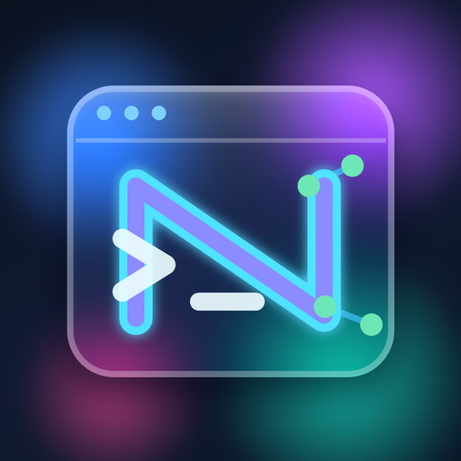
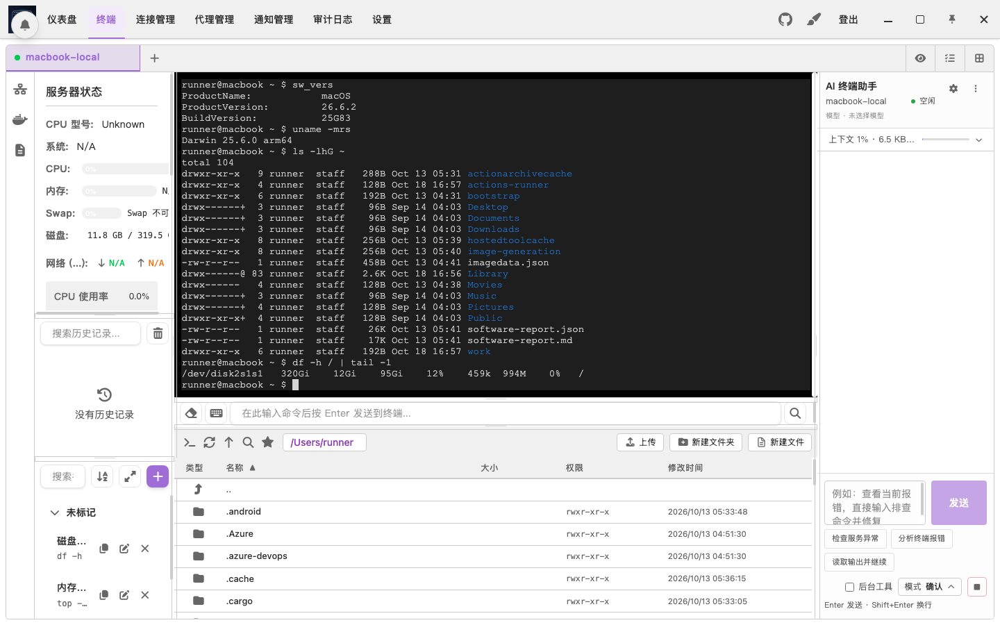
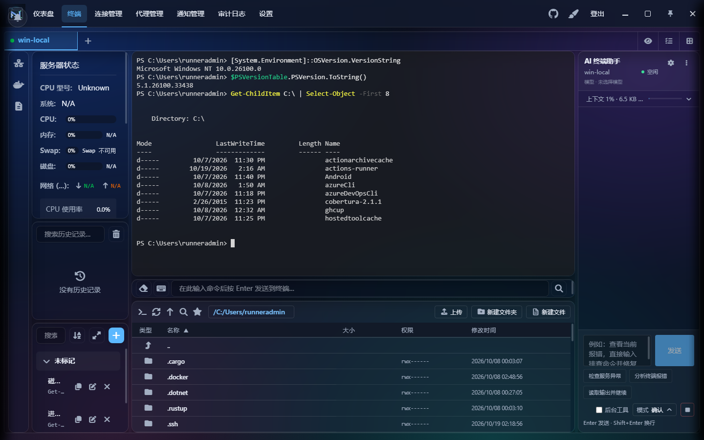
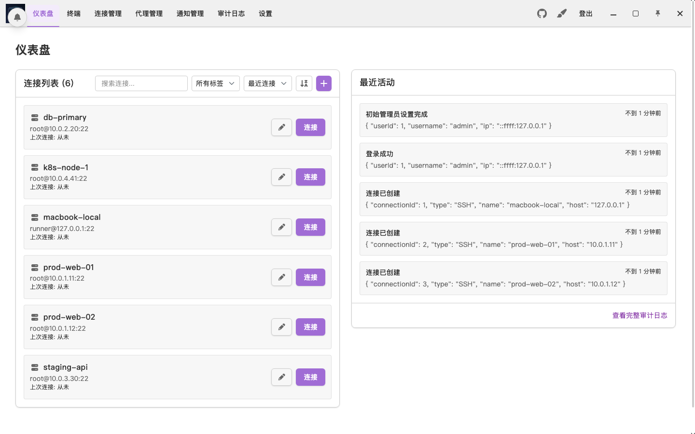
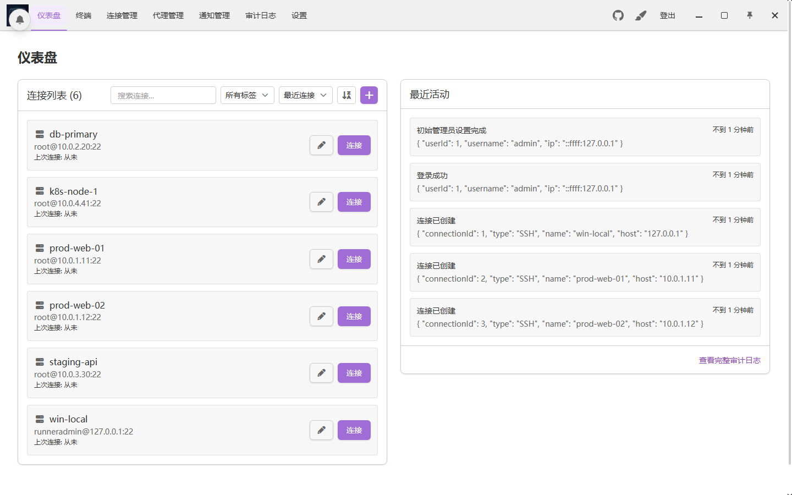

<div align="center">



# 星枢终端 · Nexus Terminal

**一个窗口，掌控所有服务器。**

SSH · SFTP · RDP · VNC · Docker · AI Agent —— 自托管的 Web 版，与 Windows / macOS 原生桌面端，同一套体验。

[](https://github.com/caichengle666/nexus-terminal/releases/latest)
[](https://github.com/caichengle666/nexus-terminal/releases)
[](https://github.com/caichengle666?tab=packages&repo_name=nexus-terminal)
[](./LICENSE)

[**下载桌面端**](https://github.com/caichengle666/nexus-terminal/releases/latest) · [**一键部署**](#-一键部署-web-版) · [**功能一览**](#-为什么选择星枢终端) · [English](./doc/README_EN.md)

<br/>



<sub>macOS 桌面端：终端、文件管理、AI 助手与快捷指令同屏协作</sub>

</div>

---

## ✨ 为什么选择星枢终端

<table>
<tr>
<td width="50%" valign="top">

### 🖥️ 全协议，一个工作台
SSH 多标签、SFTP 文件管理、RDP / VNC 远程桌面、Docker 容器面板，全部收进一个可自由拖拽的布局里。不用再在五个工具之间来回切换。

</td>
<td width="50%" valign="top">

### 🤖 会动手的 AI 运维助手
AI Agent 读得懂当前终端上下文，按你的自然语言目标自己分析、调用终端工具、判断下一步；危险命令先确认，随时一键停止，接近上限时自动压缩上下文。

</td>
</tr>
<tr>
<td width="50%" valign="top">

### 🔌 断网不断会话
WebSocket 断线自动重连并接回原 SSH 会话，输出不丢；“挂起会话”让编译、长任务在你关掉网页后依旧在后台运行，随时恢复。

</td>
<td width="50%" valign="top">

### 🛡️ 为暴露在公网而设计
人机验证（hCaptcha / reCAPTCHA）、两步验证、Passkey、IP 黑白名单与自动封禁、SSH 主机密钥校验、完整审计日志、登录与异常通知。

</td>
</tr>
<tr>
<td width="50%" valign="top">

### 🎨 每个像素都能定制
六套 UI 主题预设、400+ 终端配色、HTML 动态背景、自定义字体与布局；Monaco 编辑器在线改文件，移动端双指缩放字体。

</td>
<td width="50%" valign="top">

### 📦 Web 与桌面，两种形态
Docker 一键部署到服务器，浏览器随处访问，支持 PWA；也可以直接下载 Windows 安装版 / 便携版、macOS（Apple 芯片与 Intel）桌面端，内置在线更新与 SHA-256 校验。

</td>
</tr>
</table>

## 📸 实机截图

> 以下截图由 CI 在 GitHub 的 macOS 与 Windows 虚拟机上安装正式发布版、连接本机 SSH 后自动拍摄，所见即所得。

<table>
<tr>
<th width="50%">macOS</th>
<th width="50%">Windows</th>
</tr>
<tr>
<td></td>
<td></td>
</tr>
<tr>
<td align="center"><sub>工作区 · zsh over SSH</sub></td>
<td align="center"><sub>工作区 · PowerShell over SSH</sub></td>
</tr>
<tr>
<td></td>
<td></td>
</tr>
<tr>
<td align="center"><sub>仪表盘 · 连接与审计一目了然</sub></td>
<td align="center"><sub>仪表盘</sub></td>
</tr>
</table>

## 🧩 功能全景

| 领域 | 能力 |
| --- | --- |
| **连接** | SSH / SFTP 多标签 · RDP / VNC · 跳板机链 · HTTP / SOCKS5 代理 · SSH 密钥管理 · 批量导入导出 · 标签分组 |
| **终端** | xterm.js · 搜索 · bracketed paste · 输入法友好 · 命令输入栏多会话同步 · 命令历史 · 快捷指令（支持变量） · 一键发送到全部会话 |
| **文件** | 拖拽上传文件夹 · 传输进度与取消 · 跨服务器发送文件 · 权限修改 · 收藏路径与路径历史 · Monaco 在线编辑 · 编码切换 |
| **AI** | 终端上下文感知 · 自动 / 确认两种执行模式 · 危险命令拦截 · 流式输出与随时停止 · 会话历史 · 上下文智能压缩 |
| **运维** | 服务器状态监控（CPU / 内存 / 磁盘 / 网络） · Docker 容器管理 · 挂起会话与日志导出 |
| **安全** | 2FA · Passkey · hCaptcha / reCAPTCHA · IP 黑白名单 · 主机密钥 TOFU 校验 · 审计日志 · Webhook / Telegram / 邮件通知 |
| **体验** | 可拖拽布局 · 6 套 UI 主题 + 400+ 终端配色 · HTML 背景 · 中 / 英 / 日三语 · PWA · 移动端适配 |
| **数据** | WebDAV 加密完整备份与恢复 · 恢复前自动快照 |

---

## 💻 桌面端

前往 [**Releases**](https://github.com/caichengle666/nexus-terminal/releases/latest) 下载：

| 平台 | 文件 | 说明 |
| --- | --- | --- |
| Windows | `Nexus Terminal Setup x.x.x.exe` | 安装版，可自定义安装目录，推荐日常使用 |
| Windows | `Nexus Terminal Portable win-unpacked.zip` | 便携版，解压即用，数据保存在解压目录 |
| macOS · Apple 芯片 | `Nexus Terminal-x.x.x-macOS-arm64.dmg` | 打开后拖入“应用程序” |
| macOS · Intel | `Nexus Terminal-x.x.x-macOS-x64.dmg` | 打开后拖入“应用程序” |

> 桌面端去掉了仅 Web 端需要的功能（登录验证、会话挂起等）。macOS 安装包未经 Apple 公证，首次打开请在“系统设置 → 隐私与安全性”中点“仍要打开”。在线更新会校验 SHA-256，并自动使用系统代理。

## 🚀 一键部署 Web 版

> 推荐 Debian / Ubuntu，AMD64 或 ARM64。项目镜像不提供 ARMv7。

```bash
curl -fsSL https://raw.githubusercontent.com/caichengle666/nexus-terminal/main/install.sh | bash
```

一路回车即可完成默认安装（目录 `/opt/nexus-terminal`）。重复执行同一命令即可**升级**，脚本会备份 Compose 与 `.env`，`data` 不会被覆盖。

<details>
<summary><b>更多安装选项</b></summary>

无交互安装：

```bash
curl -fsSL https://raw.githubusercontent.com/caichengle666/nexus-terminal/main/install.sh | bash -s -- --non-interactive
```

指定目录与版本：

```bash
curl -fsSL https://raw.githubusercontent.com/caichengle666/nexus-terminal/main/install.sh | bash -s -- --dir /srv/nexus-terminal --tag 0.9.22.45
```

ARM64 会自动使用兼容的 `guacamole/guacd:1.6.0-RC1` 镜像。手动部署可直接使用仓库中的 `docker-compose.yml`：

```bash
docker compose pull && docker compose up -d
```

首次启动且没有任何用户时，后端会在日志里打印一次性初始设置令牌：`docker compose logs backend`。

</details>

<details>
<summary><b>Nginx 反向代理</b></summary>

```nginx
location / {
    proxy_http_version 1.1;
    proxy_set_header Upgrade $http_upgrade;
    proxy_set_header Connection "upgrade";
    proxy_set_header X-Forwarded-For $proxy_add_x_forwarded_for;
    proxy_set_header X-Forwarded-Proto $scheme;
    proxy_set_header Host $http_host;
    proxy_set_header X-Real-IP $remote_addr;
    proxy_set_header Range $http_range;
    proxy_set_header If-Range $http_if_range;
    proxy_redirect off;
    proxy_pass http://127.0.0.1:18111;
}
```

在前面再加一层反向代理时，记得把 `.env` 里的 `TRUST_PROXY` 设为代理层数（例如 `2`），并在 HTTPS 下设置 `SESSION_COOKIE_SECURE=true`。浏览器只允许在 HTTPS 或 localhost 下复制终端内容。

</details>

<details>
<summary><b>环境变量（<code>.env</code>）</b></summary>

| 变量 | 说明 |
| --- | --- |
| `TRUST_PROXY` | 默认 `true`，只信任前端容器 nginx 这一跳写入的 `X-Forwarded-For`。外面再套反向代理时设为代理层数（如 `2`），否则 IP 白名单、审计日志看到的都是代理 IP。 |
| `SESSION_COOKIE_SECURE` | 通过 HTTPS 访问时设为 `true`。 |
| `ALLOWED_WS_ORIGINS` | 可选，逗号分隔的额外允许的 WebSocket Origin。反向代理改写了 `Host` 导致终端连不上时在此加入访问地址。 |
| `REMOTE_GATEWAY_SECRET` | 后端与远程桌面网关的共享密钥，一键脚本自动生成；手动部署可用 `openssl rand -hex 32`。 |
| `SETUP_TOKEN` | 可选，指定固定的初始设置令牌。 |
| `WS_RESUME_GRACE_SECONDS` | 默认 `180`。断网后 SSH 会话保留的秒数，期间重连会接回原会话；`0` 关闭。缓存上限 `WS_RESUME_BUFFER_BYTES`（默认 512 KB）。 |
| `SSH_MAX_EXEC_CHANNELS` | 默认 `6`。每个 SSH 连接上状态监控、Docker、AI 等 exec 通道的并发上限，为终端和 SFTP 预留 `MaxSessions` 配额。 |
| `WS_HEARTBEAT_INTERVAL_MS` / `WS_HEARTBEAT_MAX_MISSED` | 默认 `15000` / `3`，WebSocket 心跳间隔与允许连续丢失次数。 |
| `RP_ID` / `RP_ORIGIN` | 启用 Passkey 登录时需要设置。 |

</details>

<details>
<summary><b>Docker IPv6（可选）</b></summary>

在 `/etc/docker/daemon.json` 中加入以下内容后执行 `sudo systemctl restart docker`：

```json
{
  "ipv6": true,
  "fixed-cidr-v6": "fd00::/80",
  "ip6tables": true,
  "experimental": true
}
```

</details>

## ⌨️ 上手技巧

| 场景 | 操作 |
| --- | --- |
| 复制 / 粘贴 | 终端内 `Ctrl + Shift + C` / `Ctrl + Shift + V` |
| 切换标签 | 命令输入栏聚焦时 `Alt + ↑/↓` 切 SSH 标签，`Alt + ←/→` 切编辑器标签 |
| 快速切换焦点 | 按 `Alt` 在配置好的输入框之间跳转（设置 → 焦点切换器） |
| 断线重连 | 在终端或命令输入栏按回车，或再次点击同一连接 |
| 挂起会话 | SSH 标签右键（移动端长按）→ 挂起会话，关闭网页后任务继续 |
| 文件操作 | 拖拽上传文件 / 文件夹，`Ctrl` / `Shift` 多选，内部拖动即移动，右键管理权限 |
| 缩放 | 终端、文件管理器、编辑器中 `Ctrl + 滚轮`；移动端双指缩放 |
| 标签栏 | 右键可关闭其他 / 左侧 / 右侧标签；点击分组名可直接改名 |

<details>
<summary><b>注意事项</b></summary>

1. 布局中可以放两个文件管理器（实验性），同一布局暂不支持多个文本编辑器。
2. ARMv7 没有 guacd 镜像，请参考 [doc/arm/docker-compose.yml](./doc/arm/docker-compose.yml)，RDP 功能不可用。
3. WebDAV 完整备份会加密保存整个 `data` 目录（数据库、密钥、AI 会话、主题、上传文件、挂起日志）；恢复需要备份密码，恢复前会自动创建快照。旧版数据库 ZIP 备份仍可恢复，但不含 `data` 目录文件。
4. 服务器状态监控读取的是 Linux 指标，连接 macOS / Windows 主机时会显示 N/A。

</details>

---

## 💐 致谢

本仓库基于 [Heavrnl/nexus-terminal](https://github.com/Heavrnl/nexus-terminal) 分叉维护，感谢原作者 [Heavrnl](https://github.com/Heavrnl) 出色的架构与开源精神。预设终端配色来自 [iTerm2-Color-Schemes](https://github.com/mbadolato/iTerm2-Color-Schemes)。
