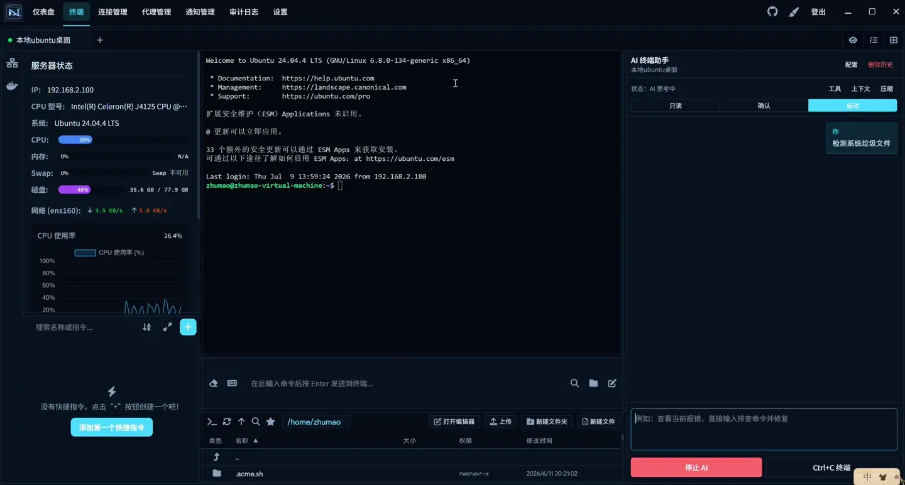
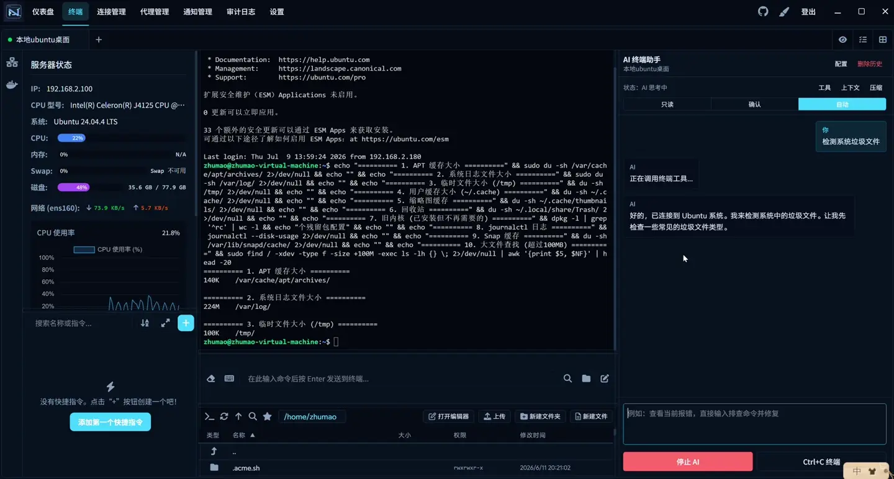
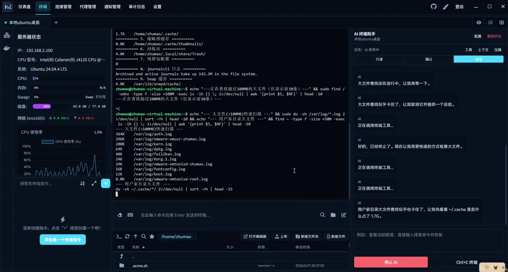

<div align="center">


# Nexus Terminal

**Every server you run, in one window.**

SSH · SFTP · RDP · VNC · Docker · AI Agent — self-hosted in the browser, or native on Windows and macOS, with the same experience everywhere.

[](https://github.com/caichengle666/nexus-terminal/releases/latest)
[](https://github.com/caichengle666/nexus-terminal/releases)
[](https://github.com/caichengle666?tab=packages&repo_name=nexus-terminal)
[](../LICENSE)

[**Download desktop app**](https://github.com/caichengle666/nexus-terminal/releases/latest) · [**Deploy in one line**](#-deploy-the-web-version) · [**Features**](#-why-nexus-terminal) · [中文](../README.md)

<br/>


<sub>The macOS app: terminal, file manager, AI assistant and quick commands side by side</sub>

</div>

---

## ✨ Why Nexus Terminal

<table>
<tr>
<td width="50%" valign="top">

### 🖥️ Every protocol, one workspace
Tabbed SSH, SFTP file management, RDP / VNC remote desktops and a Docker panel, arranged in a drag-and-drop layout you design. Stop juggling five tools.

</td>
<td width="50%" valign="top">

### 🤖 An AI agent that actually does the work
The agent reads your live terminal context, plans from a plain-language goal, runs terminal tools and decides the next step. Risky commands ask first, you can stop it any time, and long sessions are compressed automatically.

</td>
</tr>
<tr>
<td width="50%" valign="top">

### 🔌 Sessions that survive the network
Dropped WebSockets reconnect and re-attach to the same SSH session with no lost output. Suspend a session and your build keeps running after you close the tab.

</td>
<td width="50%" valign="top">

### 🛡️ Built to face the internet
hCaptcha / reCAPTCHA, 2FA, passkeys, IP allow / deny lists with auto-ban, SSH host-key pinning, full audit logs and login / anomaly notifications.

</td>
</tr>
<tr>
<td width="50%" valign="top">

### 🎨 Make it yours
Six UI theme presets, 400+ terminal color schemes, animated HTML backgrounds, custom fonts and layouts, Monaco for in-place file editing, pinch-to-zoom on mobile.

</td>
<td width="50%" valign="top">

### 📦 Web or desktop
One-line Docker deployment with PWA support, or native builds for Windows (installer and portable) and macOS (Apple silicon and Intel) with built-in, SHA-256 verified updates.

</td>
</tr>
</table>

## 📸 Real screenshots

> Captured automatically in CI: the published release is installed on GitHub's macOS and Windows machines, connected to the local SSH server, and photographed.

<table>
<tr>
<th width="50%">macOS</th>
<th width="50%">Windows</th>
</tr>
<tr>
<td></td>
<td></td>
</tr>
<tr>
<td align="center"><sub>Workspace · zsh over SSH</sub></td>
<td align="center"><sub>Workspace · PowerShell over SSH</sub></td>
</tr>
<tr>
<td></td>
<td></td>
</tr>
<tr>
<td align="center"><sub>Dashboard · connections and audit trail</sub></td>
<td align="center"><sub>Dashboard</sub></td>
</tr>
</table>

### 🎬 AI agent in action

| Ask in plain language | It calls terminal tools | Keeps reasoning, stop any time |
|:---:|:---:|:---:|
|  |  |  |

Full video: [Nexus Terminal AI Agent Demo](https://github.com/caichengle666/nexus-terminal/releases/download/0.9.9/Nexus-Terminal-0.9.9-AI-Agent-Demo.mp4)

## 🧩 Feature map

| Area | What you get |
| --- | --- |
| **Connections** | Tabbed SSH / SFTP · RDP / VNC · jump-host chains · HTTP / SOCKS5 proxies · SSH key manager · bulk import / export · tag groups |
| **Terminal** | xterm.js · search · bracketed paste · IME friendly · command bar synced across sessions · history · quick commands with variables · broadcast to all sessions |
| **Files** | Folder drag-and-drop upload · transfer progress and cancel · send files between servers · chmod · favorite paths and path history · Monaco editor · encoding switch |
| **AI** | Terminal-aware context · auto / confirm execution modes · risky-command guard · streaming with stop · conversation history · smart context compression |
| **Ops** | Server status (CPU / memory / disk / network) · Docker containers · suspended sessions with log export |
| **Security** | 2FA · passkeys · hCaptcha / reCAPTCHA · IP allow / deny lists · host-key TOFU · audit log · Webhook / Telegram / email notifications |
| **Experience** | Drag-and-drop layout · 6 UI themes + 400+ terminal schemes · HTML backgrounds · Chinese / English / Japanese · PWA · mobile |
| **Data** | Encrypted full WebDAV backup and restore · automatic snapshot before restore |

---

## 💻 Desktop app

Grab it from [**Releases**](https://github.com/caichengle666/nexus-terminal/releases/latest):

| Platform | File | Notes |
| --- | --- | --- |
| Windows | `Nexus Terminal Setup x.x.x.exe` | Installer with a custom install path — recommended |
| Windows | `Nexus Terminal Portable win-unpacked.zip` | Portable, unzip and run; data stays next to the app |
| macOS · Apple silicon | `Nexus Terminal-x.x.x-macOS-arm64.dmg` | Drag into Applications |
| macOS · Intel | `Nexus Terminal-x.x.x-macOS-x64.dmg` | Drag into Applications |

> The desktop app drops web-only features (login challenges, session suspension). The macOS build is not notarized: on first launch, choose “Open Anyway” in System Settings → Privacy & Security. In-app updates verify SHA-256 and honour your system proxy.

## 🚀 Deploy the web version

> Debian / Ubuntu on AMD64 or ARM64 recommended. ARMv7 images are not provided.

```bash
curl -fsSL https://raw.githubusercontent.com/caichengle666/nexus-terminal/main/install.sh | bash
```

Press Enter through the prompts for a default install in `/opt/nexus-terminal`. Run the same command again to **upgrade** — it backs up Compose and `.env`, and never touches `data`.

<details>
<summary><b>More install options</b></summary>

Non-interactive:

```bash
curl -fsSL https://raw.githubusercontent.com/caichengle666/nexus-terminal/main/install.sh | bash -s -- --non-interactive
```

Custom directory and version:

```bash
curl -fsSL https://raw.githubusercontent.com/caichengle666/nexus-terminal/main/install.sh | bash -s -- --dir /srv/nexus-terminal --tag 0.9.22.45
```

ARM64 automatically uses the compatible `guacamole/guacd:1.6.0-RC1` image. For a manual deployment, use the repository's `docker-compose.yml`:

```bash
docker compose pull && docker compose up -d
```

On first start with no users, the backend prints a one-time setup token: `docker compose logs backend`.

</details>

<details>
<summary><b>Nginx reverse proxy</b></summary>

```nginx
location / {
    proxy_http_version 1.1;
    proxy_set_header Upgrade $http_upgrade;
    proxy_set_header Connection "upgrade";
    proxy_set_header X-Forwarded-For $proxy_add_x_forwarded_for;
    proxy_set_header X-Forwarded-Proto $scheme;
    proxy_set_header Host $http_host;
    proxy_set_header X-Real-IP $remote_addr;
    proxy_set_header Range $http_range;
    proxy_set_header If-Range $http_if_range;
    proxy_redirect off;
    proxy_pass http://127.0.0.1:18111;
}
```

With an extra proxy in front, set `TRUST_PROXY` in `.env` to the number of proxy hops (e.g. `2`), and set `SESSION_COOKIE_SECURE=true` behind HTTPS. Browsers only allow copying terminal text over HTTPS or on localhost.

</details>

<details>
<summary><b>Environment variables (<code>.env</code>)</b></summary>

| Variable | Description |
| --- | --- |
| `TRUST_PROXY` | Default `true`: only the frontend container's nginx hop is trusted for `X-Forwarded-For`. Set to the hop count (e.g. `2`) behind another reverse proxy, or IP rules and audit logs will see the proxy's IP. |
| `SESSION_COOKIE_SECURE` | Set to `true` when served over HTTPS. |
| `ALLOWED_WS_ORIGINS` | Optional, comma-separated extra WebSocket origins. Add your public URL if a proxy rewrites `Host` and the terminal cannot connect. |
| `REMOTE_GATEWAY_SECRET` | Shared secret between backend and remote-desktop gateway; generated by the installer, or `openssl rand -hex 32` by hand. |
| `SETUP_TOKEN` | Optional fixed initial setup token. |
| `WS_RESUME_GRACE_SECONDS` | Default `180`. How long an SSH session is kept after the browser drops; reconnecting re-attaches it. `0` disables. Buffer capped by `WS_RESUME_BUFFER_BYTES` (default 512 KB). |
| `SSH_MAX_EXEC_CHANNELS` | Default `6`. Concurrent exec channels per SSH connection (status, Docker, AI), keeping `MaxSessions` headroom for the terminal and SFTP. |
| `WS_HEARTBEAT_INTERVAL_MS` / `WS_HEARTBEAT_MAX_MISSED` | Default `15000` / `3`. WebSocket heartbeat interval and allowed misses. |
| `RP_ID` / `RP_ORIGIN` | Required to enable passkey login. |

</details>

<details>
<summary><b>Docker IPv6 (optional)</b></summary>

Add this to `/etc/docker/daemon.json`, then run `sudo systemctl restart docker`:

```json
{
  "ipv6": true,
  "fixed-cidr-v6": "fd00::/80",
  "ip6tables": true,
  "experimental": true
}
```

</details>

## ⌨️ Tips

| Task | How |
| --- | --- |
| Copy / paste | `Ctrl + Shift + C` / `Ctrl + Shift + V` in the terminal |
| Switch tabs | With the command bar focused: `Alt + ↑/↓` for SSH tabs, `Alt + ←/→` for editor tabs |
| Jump between inputs | Press `Alt` to cycle the inputs you configured (Settings → Focus Switcher) |
| Reconnect | Press Enter in the terminal or command bar, or click the same connection again |
| Suspend a session | Right-click the SSH tab (long-press on mobile) → Suspend; work continues after you close the page |
| Files | Drag files or folders in, `Ctrl` / `Shift` to multi-select, drag inside to move, right-click for permissions |
| Zoom | `Ctrl + wheel` in terminal, file manager and editor; pinch on mobile |
| Tab bar | Right-click to close others / left / right; click a group name to rename it |

<details>
<summary><b>Notes</b></summary>

1. A layout can hold two file managers (experimental); multiple text editors in one layout are not supported yet.
2. ARMv7 has no guacd image; see [arm/docker-compose.yml](./arm/docker-compose.yml) — RDP is unavailable there.
3. Full WebDAV backups encrypt the whole `data` directory (database, keys, AI sessions, themes, uploads, suspended-session logs). Restoring needs the backup password and snapshots current data first. Legacy database ZIP backups still restore but do not include `data` files.
4. Server status reads Linux metrics, so it shows N/A for macOS / Windows hosts.

</details>

---

## 💐 Acknowledgements

This repository is a maintained fork of [Heavrnl/nexus-terminal](https://github.com/Heavrnl/nexus-terminal) — thanks to [Heavrnl](https://github.com/Heavrnl) for the excellent foundation. Terminal color presets come from [iTerm2-Color-Schemes](https://github.com/mbadolato/iTerm2-Color-Schemes).

If Nexus Terminal helps you, a ⭐ goes a long way — or [buy the original author a coffee](https://ko-fi.com/0heavrnl).

## 📄 License

[GPL-3.0](../LICENSE)
